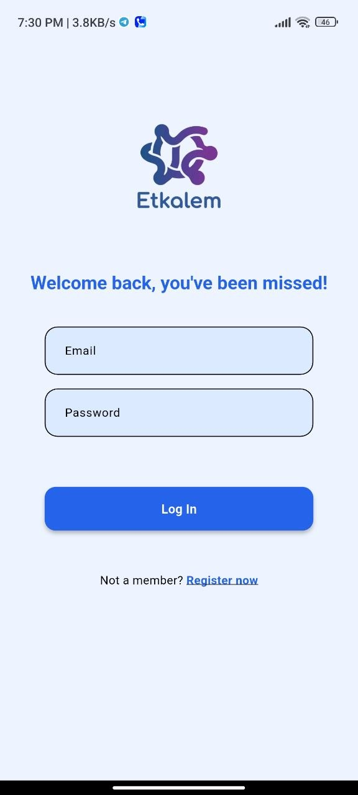
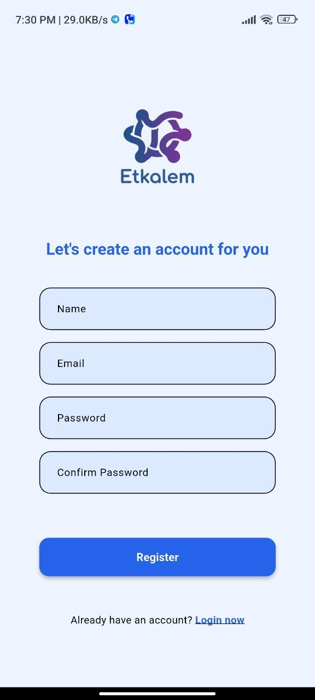
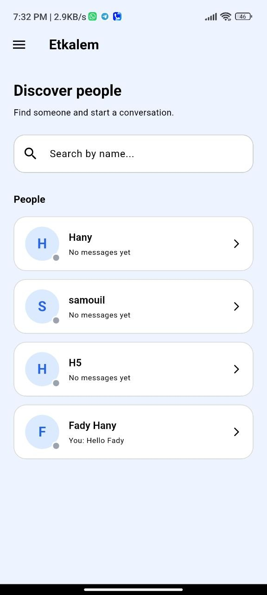
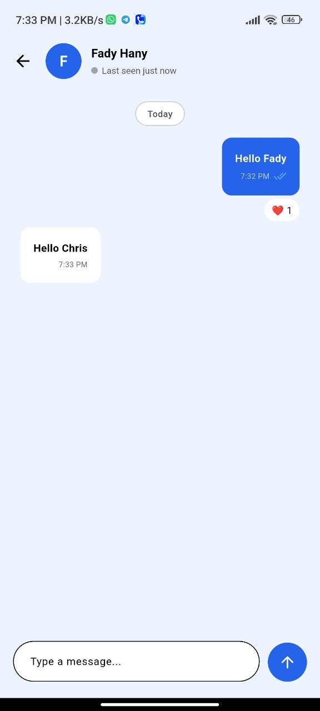
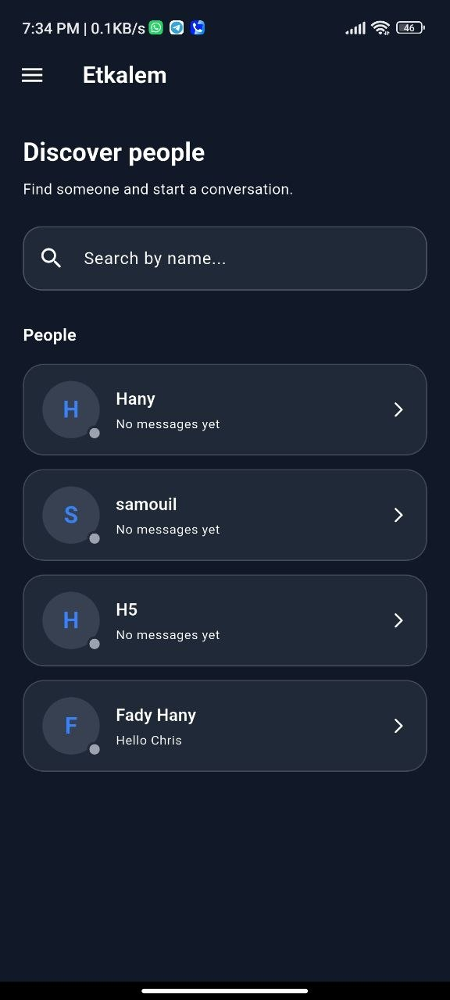
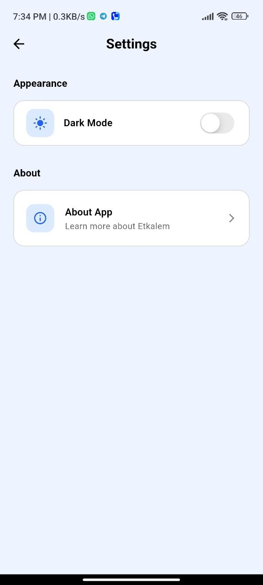

# Etkalem 💬

A real-time chat application built with Flutter and Firebase, featuring instant messaging, online presence, and message status tracking.

## 📱 About

**Etkalem** is a cross-platform messaging application developed using Flutter and Firebase. It provides users with a simple and interactive way to communicate through real-time conversations.

The application focuses on smooth messaging, user presence, and a clean interface with support for both light and dark themes.

## ✨ Features

- **User Authentication:** Sign in and registration using Firebase Authentication.
- **Real-Time Messaging:** Send and receive messages instantly.
- **Online Presence:** View users' online and offline status.
- **Last Seen:** Display users' last active time.
- **Message Status:** Track message delivery and read status.
- **Message Management:** Edit and delete your own messages.
- **Message Reactions:** React to messages.
- **Reply to Messages:** Reply directly to specific messages.
- **Chat Interface:** Organized conversations with date separators.
- **Theme Support:** Switch between light and dark modes.
- **User Profiles:** View user profile information.
- **Settings:** Manage application preferences.

## 🖼️ Screenshots

| Splash | Login |
|:---:|:---:|
|  |  |

| Sign Up | Home |
|:---:|:---:|
|  |  |

| Chat | Dark Mode |
|:---:|:---:|
|  |  |

| Profile | Settings |
|:---:|:---:|
|  |  |

## 🛠️ Tech Stack

| Technology | Usage |
|---|---|
| Flutter | Cross-platform application development |
| Dart | Programming language |
| Firebase Authentication | User authentication |
| Cloud Firestore | Real-time messaging and user data |
| Firebase Realtime Database | Online presence and active chat tracking |
| Provider | State management |
| Node.js & Express | Backend services |
| Firebase Admin SDK | Server-side Firebase integration |
| Git & GitHub | Version control |

## 📁 Project Structure

```text
lib/
├── core/
│   ├── resources/
│   │   └── asstes.dart
│   └── widgets/
│       ├── chat_bubble.dart
│       ├── logo_body.dart
│       ├── my_button.dart
│       ├── my_drawer.dart
│       ├── my_textfield.dart
│       └── user_tile.dart
│
├── features/
│   ├── auth/
│   └── chat/
│       ├── models/
│       ├── services/
│       ├── views/
│       └── widgets/
│
├── models/
│   └── message.dart
│
├── screens/
│   ├── chat/
│   │   ├── chat_screen.dart
│   │   └── widgets/
│   │       ├── chat_date_separator.dart
│   │       ├── chat_input.dart
│   │       ├── chat_message_item.dart
│   │       ├── chat_message_list.dart
│   │       ├── edit_message_dialog.dart
│   │       └── empty_chat_widget.dart
│   │
│   ├── home/
│   │   ├── home_screen.dart
│   │   └── widgets/
│   │       └── user_list_skeleton.dart
│   │
│   ├── profile/
│   │   └── profile_screen.dart
│   │
│   ├── settings/
│   │   ├── about_screen.dart
│   │   └── settings_screen.dart
│   │
│   ├── registration_screen.dart
│   ├── signin_screen.dart
│   └── splash_screen.dart
│
├── services/
│   ├── auth/
│   │   ├── auth_gate.dart
│   │   ├── auth_service.dart
│   │   ├── login_or_register.dart
│   │   └── presence_service.dart
│   │
│   ├── chat/
│   │   └── chat_service.dart
│   │
│   └── notifications/
│       └── notification_service.dart
│
├── themes/
│   ├── dark_mode.dart
│   ├── light_mode.dart
│   └── theme_provider.dart
│
├── firebase_options.dart
└── main.dart
```

## 🚀 Getting Started

Follow these steps to run Etkalem locally.

### Prerequisites

Make sure you have the following installed:

- Flutter SDK
- Dart SDK
- Android Studio or Visual Studio Code
- Node.js and npm
- A Firebase project

### 1. Clone the Repository

```bash
git clone https://github.com/Fodzoo/Etkalem.git
```

### 2. Open the Project

```bash
cd Etkalem
```

### 3. Install Dependencies

```bash
flutter pub get
```

### 4. Configure Firebase

To run the application with your own Firebase project:

1. Create a project in the [Firebase Console](https://console.firebase.google.com/).
2. Configure Firebase for your Flutter platforms using the FlutterFire CLI.
3. Enable Firebase Authentication.
4. Set up Cloud Firestore.
5. Set up Firebase Realtime Database.
6. Configure the required Firebase security rules.

### 5. Run the Application

```bash
flutter run
```

## ⚙️ Backend Setup

Etkalem includes a separate Node.js backend for server-side functionality.

### 1. Navigate to the Backend Directory

```bash
cd etkalem-backend
```

### 2. Install Dependencies

```bash
npm install
```

### 3. Configure Firebase Admin SDK

Add your Firebase Admin SDK service account file:

```text
etkalem-backend/
└── serviceAccountKey.json
```

Keep this file private and never upload it to GitHub.

### 4. Start the Backend

```bash
npm start
```

## 🔐 Security Notes

- Never commit Firebase Admin SDK credentials.
- Keep private environment variables out of version control.
- Configure Firebase security rules before using your own Firebase project.

## 👨‍💻 Developer

**Fady Hany**

- GitHub: [@Fodzoo](https://github.com/Fodzoo)

## 📄 License

This project was developed for learning and portfolio purposes.

---

Made with ❤️ using Flutter & Firebase.